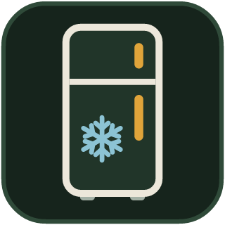

# ioBroker.liebherr-home

**Tests:** 

German documentation: [docs/de/README.md](docs/de/README.md)

---

## Liebherr SmartDevice adapter for ioBroker

Reads and controls Liebherr fridges and freezers via the official, cloud-based **Liebherr SmartDevice HomeAPI**.

### Features
- Current and target temperature per zone, SuperCool / SuperFrost, night mode, party mode
- HydroBreeze, IceMaker, BioFresh-Plus and presentation light, if the appliance has them
- Automatic door: status, and opening/closing only if explicitly enabled in the settings
- Real-time updates via Server-Sent Events, polling continues as resync
- Only what an appliance reports is created; unknown functions are kept as raw JSON, so new
  features become visible without an adapter update
- Serial numbers never appear in object IDs, states or logs
- VIS-2 widget: a tile per appliance with a dialog to control it (see below)

### Requirements
- Liebherr appliances connected in the **SmartDevice app** (the HomeAPI only sees appliances that are online there)
- A HomeAPI key from the SmartDevice app (see below)
- Node.js 22 or newer, js-controller 6.0.11 or newer, admin 7.6.20 or newer
- Internet access from the ioBroker host to `home-api.smartdevice.liebherr.com`

### Getting the API key
In the SmartDevice app: *Settings* → *Become a beta tester* → activate *Beta testing HomeAPI* → *Generate new key*.
Copy the key right away, it is shown only once. Generating a new key invalidates the old one – the adapter then
reports "rejected the API key" until you enter the new key.

The HomeAPI is a beta service by Liebherr; fields and endpoints may change.

### Installation
Install the adapter in Admin on the *Adapters* page, then add an instance and enter the API key.

The adapter is not yet listed in the ioBroker repositories.

### Configuration
| Setting | Description |
|---|---|
| API key | Key from the SmartDevice app. Stored encrypted. |
| Real-time updates (SSE) | One event stream per appliance; changes arrive within seconds. Polling remains active as resync. |
| Allow opening and closing automatic doors | Creates a command state per automatic door. **The door moves physically** – only enable this if nobody can get hurt. Off by default. |
| Polling interval | Seconds (60–3600, default 300). |

### States
Each appliance gets a device `liebherr-home.<n>.<type>_<id>`, e.g. `fridge_3f9a1c2e`. The id is derived from the
serial number with a keyed hash (HMAC) and a random salt per instance, so it cannot be traced back to the
serial number. It stays the same as long as the instance exists; a new instance creates new ids.

**`info.*`** (read-only)

| State | Type | Description |
|---|---|---|
| `name` | string | Name of the appliance in the SmartDevice app |
| `model` | string | Model, e.g. `IRBbi 4170-150 2` |
| `type` | string | `FRIDGE`, `FREEZER`, `COMBI`, `WINE` |
| `reachable` | boolean | The cloud can reach the appliance |
| `lastUpdate` | number | Last data from the cloud (ms since epoch) |

**`zones.<n>.*`** – one channel per zone (`Zone 0 (top)` …)

| State | Type | Writable | Description |
|---|---|---|---|
| `temperature` | number °C/°F | – | Current temperature |
| `setpoint` | number °C/°F | ✓ | Target temperature, whole degrees within the appliance limits (`min`/`max` in the object) |
| `supercool` / `superfrost` | boolean | ✓ | SuperCool / SuperFrost |
| `hydrobreeze` | string | ✓ | `OFF`, `LOW`, `MEDIUM`, `HIGH` |
| `icemaker` | string | ✓ | `OFF`, `ON`, `MAX_ICE` (if supported) |
| `biofreshplus` | string | ✓ | Modes the appliance supports |
| `autodoor` | string | – | `CLOSED`, `OPEN`, `MOVING` |
| `autodoorCommand` | boolean | ✓ | `true` opens, `false` closes – only with the setting enabled |

**`functions.*`** – functions without a zone

| State | Type | Writable | Description |
|---|---|---|---|
| `nightmode` | boolean | ✓ | Night mode |
| `partymode` | boolean | ✓ | Party mode (the appliance switches SuperCool on with it) |
| `presentationlight` | number | ✓ | Brightness 0 … max |

**`raw.*`** – controls of unknown type as JSON (read-only).

**Instance states:** `info.connection` (HomeAPI reachable, key accepted) and `info.realtime` (event streams of all appliances open).

#### Commands
Commands are checked before they are sent (range, whole degrees, allowed modes). Invalid values are not sent;
the state returns to the real value and the log shows why. Quick changes (e.g. a slider) are combined, only the
last value is sent. After the cloud accepts a command, the adapter reads the value back and confirms it with
`ack: true`. If a command fails, the last confirmed value is restored.

### VIS-2 widget
The adapter brings its own VIS-2 widget set **Liebherr** (installed together with the adapter; VIS-2 restarts once
to pick it up).

1. In the VIS-2 editor, drag **Liebherr appliance** from the palette onto a view.
2. Tick the attribute group **Appliance** on the right and select the device folder in **Appliance (device folder)**,
   e.g. `liebherr-home.0.fridge_3f9a1c2e` (any state inside the folder works as well).
3. Optional: a **Name**; empty = the name from the SmartDevice app.

The **tile** shows the current and target temperature, chips for active functions and a status dot
(green = real time, amber = command pending or polling only, red = appliance not reachable).
A click opens the **dialog**: target temperature with −/+ within the limits of the appliance, HydroBreeze /
IceMaker / BioFresh modes as buttons, switches for SuperCool, SuperFrost, party and night mode, and a status line.
Only buttons, no sliders. Every press is sent right away; the dialog waits for the confirmation of the adapter and
shows "not confirmed" and the previous value if none arrives within 15 s. Below 500 px the dialog fills the screen.
The widget only offers what the appliance reports and what is writable. Fonts (Barlow, SIL OFL) are bundled,
nothing is loaded from the internet.

### Security
- The API key is stored encrypted and never written to logs, URLs or states.
- Serial numbers are masked in all log messages and never stored in objects or states.
- Automatic doors can only be moved after enabling the setting for it.
- Please report security issues privately as described in [SECURITY.md](SECURITY.md).

### Known limitations
- The HomeAPI is a beta service; Liebherr may change it at any time.
- Temperatures are whole degrees only (the API has no decimals).
- There is no online flag; an appliance counts as unreachable when the cloud answers "device not reachable".
- Rate limits of the HomeAPI are not documented; the adapter respects HTTP 429 and `Retry-After` if they occur.
- Bottle timer and holiday mode exist in the SmartDevice app but not in the HomeAPI, so the adapter cannot offer them.
- Tested with a fridge (IRBbi 4170) and a freezer (GNP 3755). IceMaker, BioFresh-Plus, presentation light,
  automatic door and °F appliances are implemented from the API specification but not tested on real appliances.

---

## Disclaimer

This project is not affiliated with, endorsed by or connected to Liebherr.
Liebherr and SmartDevice are trademarks of their respective owners. Use at your own risk.

This adapter is an independent implementation based on the official HomeAPI specification; it contains no code
from other Liebherr adapters.

## Changelog
<!--
    Placeholder for the next version (at the beginning of the line):
    ### **WORK IN PROGRESS**
-->
### **WORK IN PROGRESS**
* (Sven-83) widget files with short names (long federation chunk names could break checkouts on Windows)
* (Sven-83) ESLint for the widget set, CI checks that the committed widgets match the sources

### 0.2.0 (2026-10-23)
* (Sven-83) VIS-2 widget set "Liebherr": tile with live values and a dialog to control the appliance
* (Sven-83) own adapter icon

### 0.1.0 (2026-10-22)
* (Sven-83) first working version: appliances, zones and functions from the HomeAPI, capability based
* (Sven-83) writable target temperature, SuperCool/SuperFrost, night and party mode, HydroBreeze, IceMaker,
  BioFresh-Plus, presentation light; checked before sending and confirmed by reading back
* (Sven-83) real-time updates via Server-Sent Events (`info.realtime`), polling as resync
* (Sven-83) automatic doors only behind an explicit setting
* (Sven-83) serial numbers masked in object IDs and logs, API key stored encrypted
* (Sven-83) HTTP 429 / Retry-After respected, quiet log during cloud outages, random start delay

## License
MIT License

Copyright (c) 2026 Sven-83 <276080681+Sven-83@users.noreply.github.com>

Permission is hereby granted, free of charge, to any person obtaining a copy
of this software and associated documentation files (the "Software"), to deal
in the Software without restriction, including without limitation the rights
to use, copy, modify, merge, publish, distribute, sublicense, and/or sell
copies of the Software, and to permit persons to whom the Software is
furnished to do so, subject to the following conditions:

The above copyright notice and this permission notice shall be included in all
copies or substantial portions of the Software.

THE SOFTWARE IS PROVIDED "AS IS", WITHOUT WARRANTY OF ANY KIND, EXPRESS OR
IMPLIED, INCLUDING BUT NOT LIMITED TO THE WARRANTIES OF MERCHANTABILITY,
FITNESS FOR A PARTICULAR PURPOSE AND NONINFRINGEMENT. IN NO EVENT SHALL THE
AUTHORS OR COPYRIGHT HOLDERS BE LIABLE FOR ANY CLAIM, DAMAGES OR OTHER
LIABILITY, WHETHER IN AN ACTION OF CONTRACT, TORT OR OTHERWISE, ARISING FROM,
OUT OF OR IN CONNECTION WITH THE SOFTWARE OR THE USE OR OTHER DEALINGS IN THE
SOFTWARE.
